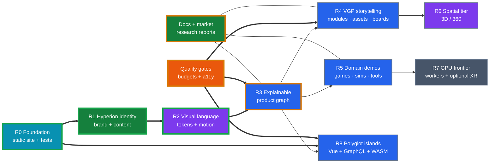

# Organization-Website — Hyperion Corporation Master Roadmap

**Last updated:** 2026-08-10 · **Roadmap session:** R5.2 · **Delivery model:** static-first progressive enhancement

This is the product-level index for the **Hyperion Corporation** organization website. Hyperion builds software that optimizes the human work of developers, artists, and designers for **games, simulations/simulators**, and related systems—especially **Visual Graph Programming (VGP)** (graph and metrics visualization of modules, assets, and storyboards).

Workstream files under [`roadmaps/`](roadmaps/) are issue-ready. Primary product research:

- [`research/Visual Development Tool Roadmap & Tech Stack.md`](research/Visual%20Development%20Tool%20Roadmap%20%26%20Tech%20Stack.md)
- [`reports/Game Dev Tools Market Research.md`](reports/Game%20Dev%20Tools%20Market%20Research.md)

## Table of contents

- [Vision and operating rules](#vision-and-operating-rules)
- [Implementation timeline](#implementation-timeline)
- [Current state](#current-state)
- [How to use this roadmap](#how-to-use-this-roadmap)
- [Phase gates](#phase-gates)
- [Workstreams](#workstreams)
- [Product-derived feature index](#product-derived-feature-index)
- [Dependency and risk register](#dependency-and-risk-register)
- [Effort × impact matrix](#effort--impact-matrix)
- [Anchor index](#anchor-index)
- [Document history](#document-history)

## Vision and operating rules

Turn this site into Hyperion’s public product surface: visitors understand **who Hyperion is**, **what VGP and related tools do**, and **how structure/metrics/relationships** help creative and engineering teams—through carefully staged interaction on a static export.

1. **Mission before ornament.** Hyperion’s claim (optimize human creative/engineering work) is visible before any canvas loads.
2. **One fact, multiple senses.** Every visualization has DOM text, keyboard controls, a list/table or download, and a reduced-motion path.
3. **Static export is a product constraint.** No runtime API, token, secret, or required server. Backend proposals are explicit forks.
4. **Capability tiers are policy.** Static, reduced, and full tiers respond to preferences, hardware, browser support, visibility, and measured performance.
5. **Product honesty is visual.** Label prototypes, demos, and market research distinctly from shipped product claims.
6. **Local by default.** Local notes, annotations, simulation inputs, and future inference stay on-device unless a visitor opts in.
7. **Every effect has a budget.** LCP ≤ 2.5 s, INP ≤ 200 ms, CLS ≤ 0.1 at p75; initial route JS ≤ 200 kB gzip excluding framework runtime; optional island ≤ 300 kB gzip; initial 3D/media ≤ 2 MB.

## Implementation timeline

## Current state

### Shipped or partially shipped

- Next.js 14 static export (`basePath: /Organization-Website` in prod; empty in `next dev`), content routes, theme shell, Vitest/RTL/MSW, Cypress, notebooks workspace.
- Hyperion branding: logo assets, org about/projects/media/posts copy, product domain constellation.
- **Helios Forge visual system (R2 / UI3–UI5 / UI15):** gold–cobalt–teal tokens on main site (`app/globals.css`, Tailwind `primary`/`helios`) and docs (`observatory.css` + Infima map); `NetworkFieldBackdrop` ambient canvas + ember drift on the main shell; docs backdrop with pulses/embers; shell nav accents aligned. Distinct from the github-pages template and from VGP/PMF palettes.
- Homepage with hero image stage, graph/DOM constellation, simulation islands, and field-note demos (copy realigned toward VGP; deeper fixtures still RR2).
- Domain UI under `src/frameworks/react/components/{audio,books,canvas,games,graph,image,maps,models,routes,video,visualization,layout,ui,graphics}`.
- Framework-neutral simulations; Astro and Aurelia island seeds; GraphQL schema still a placeholder.
- Interactive graphics IF1–IF13 marked complete in their workstream; root `benchmark/` harness.
- Optional self-host: `infra/{docker,nginx,ansible,terraform}/` only. Default deploy remains GitHub Pages.
- `public/reports/` retained as a technical HTML library; product research lives under `docs/moon/{research,reports}/`.
- Documentation dashboard (`docs/website/`) shares Helios Forge identity: tokens, ambient network field, editorial hero, hub tabs, corpus knowledge map, and the R0–R8 timeline (UI15, DOC12).

### Open risks

- Visual-regression baselines and Lighthouse gate for G2 still open (UI3 residual).
- Homepage structure demos renamed to `StructureMap` / `StructureCanvas` with VGP-oriented copy; deeper VGP fixtures still planned (RR2).
- Vue 3 dual-runtime cost and Next App Router loader conflicts unproven.
- GraphQL/Apollo must stay static-export safe.
- WASM OOM / main-thread jank without workers, memory gates, and pure-TS fallbacks.
- Market research claims must not be presented as Hyperion product metrics without attribution.
- Main-site and docs tokens are parallel files (`--helios-*` / `--hy-*`); risk of palette drift without a single source of truth.

## How to use this roadmap

1. Read the timeline and current-status table before starting.
2. Read the item’s problem, options, acceptance criteria, tests, budgets, and risks.
3. Link implementation to a stable ID and GitHub issue. Mark `Partial` when only a minimum slice shipped.
4. Record measured results and residual risks in the item, changelog, and issue.

Status: ✅ Done · 🔄 Partial · ⬜ Planned · 🔬 Research · ⛔ Blocked. Effort: S / M / L / XL.

## Phase gates

### Gate G0 — Static contract (complete)

Core routes build on GitHub Pages; semantic content survives disabled JS; tests run deterministically.

### Gate G1 — Hyperion identity (complete / hardening)

Org branding, mission, projects (VGP), and navigation are consistent. Exit: no personal-template identity strings on user-facing routes.

### Gate G2 — Visual system (near complete / hardening)

Helios Forge tokens, ambient NetworkField, shell accents, and docs parity shipped. Residual: Lighthouse baseline, visual-regression references, capability policy (UI6), shared token package. Exit: Lighthouse baseline + keyboard/SR smoke + both themes contrast-checked.

### Gate G3 — Explainable product interaction (in progress)

Shared scales/legends/selection, product graph, DOM table equivalents. Exit: visitor reaches the same conclusion from visual and DOM paths.

### Gate G4 — VGP storytelling (planned)

Module/asset/storyboard relationship stories with fixtures, provenance, and static fallbacks.

### Gate G5 — Spatial/media (planned)

3D/panorama assets with manifests, licenses, thumbnails, disposal tests.

### Gate G6 — GPU/experimental (research)

WebGPU/XR only after a device matrix proves user-facing benefit.

### Gate G7 — Polyglot platform (planned)

React host; Vue/Astro/Aurelia islands; GraphQL fixtures; optional WASM with pure-TS fallback. Exit: MF-G1–MF-G3 in [multi_framework_platform.md](roadmaps/multi_framework_platform.md).

## Workstreams

| Workstream | IDs | Detail | Current state |
| --- | --- | --- | --- |
| Visual design and UX | UI1–UI15 | [user_interface.md](roadmaps/user_interface.md) | 🔄 Helios Forge tokens + ambient; UI6–UI12 open |
| Interactive graphics | IF1–IF13 | [interactive_features.md](roadmaps/interactive_features.md) | ✅ IF1–IF13 (reframe demos for VGP) |
| Simulations and Aurelia | SIM1–SIM10 | [simulations_and_aurelia.md](roadmaps/simulations_and_aurelia.md) | 🔄 SIM1–SIM4 partial |
| Multi-framework platform | MFP1–MFP16 | [multi_framework_platform.md](roadmaps/multi_framework_platform.md) | 🔄 React/Astro/Aurelia seeds |
| Mathematical optimization | MO1–MO8 | [mathematical_optimization.md](roadmaps/mathematical_optimization.md) | 🔄 reframe toward graph/metrics tooling |
| Machine learning | ML1–ML8 | [machine_learning.md](roadmaps/machine_learning.md) | 🔄 browser ML remains optional |
| Infrastructure and quality | IT1–IT14 | [infrastructure_and_testing.md](roadmaps/infrastructure_and_testing.md) | ✅ IT1–IT5; infra layout simplified |
| Documentation/content | DOC1–DOC11 | [documentation.md](roadmaps/documentation.md) | 🔄 Hyperion research library |
| Product-derived interaction | RR1–RR10 | [research_derived_interactions.md](roadmaps/research_derived_interactions.md) | 🔬 re-anchored to VGP/market research |

## Product-derived feature index

| ID | Feature | Primary workstream | Evidence / next slice |
| --- | --- | --- | --- |
| RR1 | Hyperion mission + product graph | DOC/UI | Org about + constellation |
| RR2 | Module / asset / storyboard relationship explorer | IF/MO | VGP research + fixtures |
| RR3 | Metrics and structure comparison views | IF/MO | graphs, tables, provenance |
| RR4 | Optional ML assist (local, model card) | ML/IF | only if budgets allow |
| RR5 | Audio/media demos for creative pipelines | ML/IF | explanatory only |
| RR6 | Market/context reading room | DOC | Game Dev Tools market report |
| RR7 | Games & sims domain narrative | UI/IF | PrototypeCard + projects |
| RR8 | Annotated spatial / 360 media | IF | existing panorama path |
| RR9 | WebGPU aggregation experiment | IF/IT | capability gate + fallback |
| RR10 | Shared worker protocol | SIM/IT | cancel, transferables, seeds |

## Dependency and risk register

| ID | Risk | Mitigation |
| --- | --- | --- |
| X1 | Visualization semantics drift | typed scales/palettes/legend contract |
| X2 | Overclaiming product readiness | label prototypes; separate market research |
| X3 | Template demos confuse Hyperion story | reframe visitor copy to VGP; optional file renames later |
| X4 | WebGL context/VRAM growth | disposal, visibility suspension, reduced tier |
| X5 | Main-thread jank | workers, event-driven SVG, progressive chunks |
| X6 | Accessibility gap | DOM summary/table, keyboard path |
| X7 | Dual-framework cost | one secondary framework per route; MFP budgets |
| X8 | GraphQL runtime dependency | fixtures + MSW only by default |
| X9 | WASM memory | pure-TS fallback + capability gate |
| X10 | Infra sprawl | only docker/nginx/ansible/terraform kept |

## Effort × impact matrix

| | High impact | Medium impact | Discovery |
| --- | --- | --- | --- |
| S | RR1 mission cards; IT budget baseline | UI taxonomy cleanup | MFP ADR |
| M | RR2 VGP story; RR6 market room | DOC embed guide | WebGPU spike |
| L | RR3 metrics views; Vue island | panorama/game island | WASM worker |
| XL | — | — | live backend; edge-ML WASM |

## Anchor index

- [Visual Development Tool research](research/Visual%20Development%20Tool%20Roadmap%20%26%20Tech%20Stack.md)
- [Game Dev Tools market report](reports/Game%20Dev%20Tools%20Market%20Research.md)
- [UI visual system](roadmaps/user_interface.md)
- [G2 visual system checklist](roadmaps/g2_visual_system_checklist.md)
- [IF graphics](roadmaps/interactive_features.md)
- [SIM simulations/Aurelia](roadmaps/simulations_and_aurelia.md)
- [MFP multi-framework](roadmaps/multi_framework_platform.md)
- [MO optimization / structure](roadmaps/mathematical_optimization.md)
- [ML browser ML](roadmaps/machine_learning.md)
- [IT quality](roadmaps/infrastructure_and_testing.md)
- [DOC documentation](roadmaps/documentation.md)
- [RR product-derived](roadmaps/research_derived_interactions.md)

## Document history

| Date | Revision | Change |
| --- | --- | --- |
| 2026-08-10 | R5.2 | Helios Forge identity across main site + docs (gold/cobalt/teal; NetworkField + embers); R2 marked done on timeline; UI3–UI5 partial→hardening; G2 residual noted. |
| 2026-08-09 | R5.1 | Documentation dashboard adopts the Hyperion visual identity (UI15, DOC12); Astro island restyled and its build hazard recorded. |
| 2026-08-09 | R5 | Hyperion org-site vision; VGP-centered timeline; research anchors updated to Visual Development Tool + Game Dev Tools market; infra keepers only. |
| 2026-08-09 | R4 | Multi-framework platform workstream (MFP1–MFP16) and gate G6. |
| 2026-08-08 | R3 | Implementation playbook and review gates. |
| 2026-08-08 | R2–R1 | Research-derived index and initial progressive-enhancement vision (template era). |
