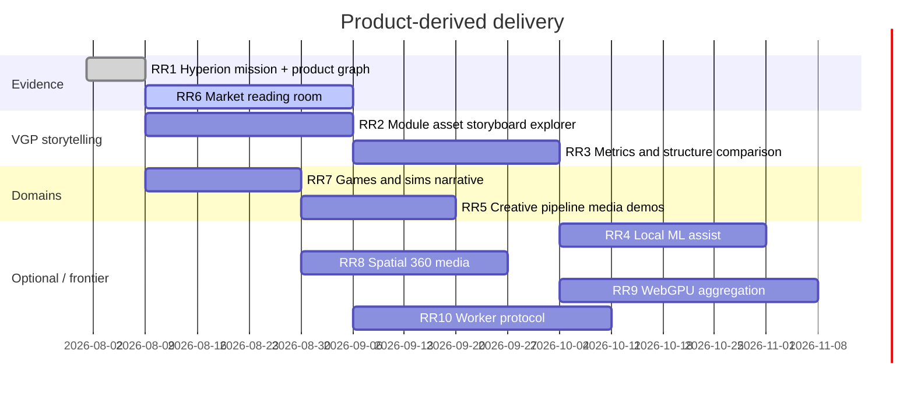

# Product-derived interaction roadmap

**Status:** Active (R5)  
**Owner:** Hyperion Corporation / Organization-Website  
**Sources:**

- [Visual Development Tool Roadmap & Tech Stack](../research/Visual%20Development%20Tool%20Roadmap%20%26%20Tech%20Stack.md)
- [Game Dev Tools Market Research](../reports/Game%20Dev%20Tools%20Market%20Research.md)

**Last updated:** 2026-08-09

## Contents

- [Operating model](#operating-model)
- [Delivery timeline](#delivery-timeline)
- [Work packages](#work-packages)
- [Acceptance and measurement](#acceptance-and-measurement)
- [Risk and decision register](#risk-and-decision-register)
- [Effort × impact](#effort--impact)

## Operating model

Each experience starts with a semantic HTML claim about Hyperion’s mission or a VGP concept, adds direct manipulation, and only then opts into canvas, 3D, audio, or WebGPU. Every enhanced view has a reduced-motion mode, keyboard path, text/data equivalent, deep-linkable state where useful, and a static recorded example. Market research and measured product results are kept separate from illustrative demos.

## Delivery timeline

## Work packages

| ID | Package | Outcome |
| --- | --- | --- |
| RR1 | Mission + product graph | Constellation and about/projects convey Hyperion → VGP → domains |
| RR2 | Relationship explorer | Fixtures for modules, assets, storyboards with graph + table |
| RR3 | Metrics comparison | Side-by-side structure/metrics without overclaiming optimality |
| RR4 | Optional local ML | Model card + recorded replay only if budgets allow |
| RR5 | Pipeline media | Explanatory audio/video slots for creative production context |
| RR6 | Market reading room | Surface Game Dev Tools market research with clear provenance |
| RR7 | Games & sims narrative | Domain cards and projects section |
| RR8 | Spatial media | Reuse panorama path with product-relevant captions |
| RR9 | WebGPU experiment | Capability-gated; SVG/WebGL fallback required |
| RR10 | Worker protocol | Versioned messages, cancel, transferables, pure-TS fallback |

## Acceptance and measurement

- Static/reduced/full paths documented per package.
- Visitor question answerable without JavaScript.
- Benchmark before/after for any new island or media.
- Market or research claims cite `docs/moon/reports` or `docs/moon/research` paths.
- Changelog + roadmap ID updated when status changes.

## Risk and decision register

| Risk | Decision |
| --- | --- |
| Template fleet/lab demos dilute Hyperion | Prefer VGP language; remove or relabel legacy demos |
| Market report read as Hyperion metrics | Always attribute third-party research |
| Graph overload | Progressive disclosure; table equivalent first |

## Effort × impact

| | High | Medium | Discovery |
| --- | --- | --- | --- |
| S | RR1 polish | DOC links | — |
| M | RR6 room; RR7 narrative | RR5 media | RR9 spike |
| L | RR2 explorer; RR3 metrics | RR8 spatial | RR4 ML; RR10 workers |
